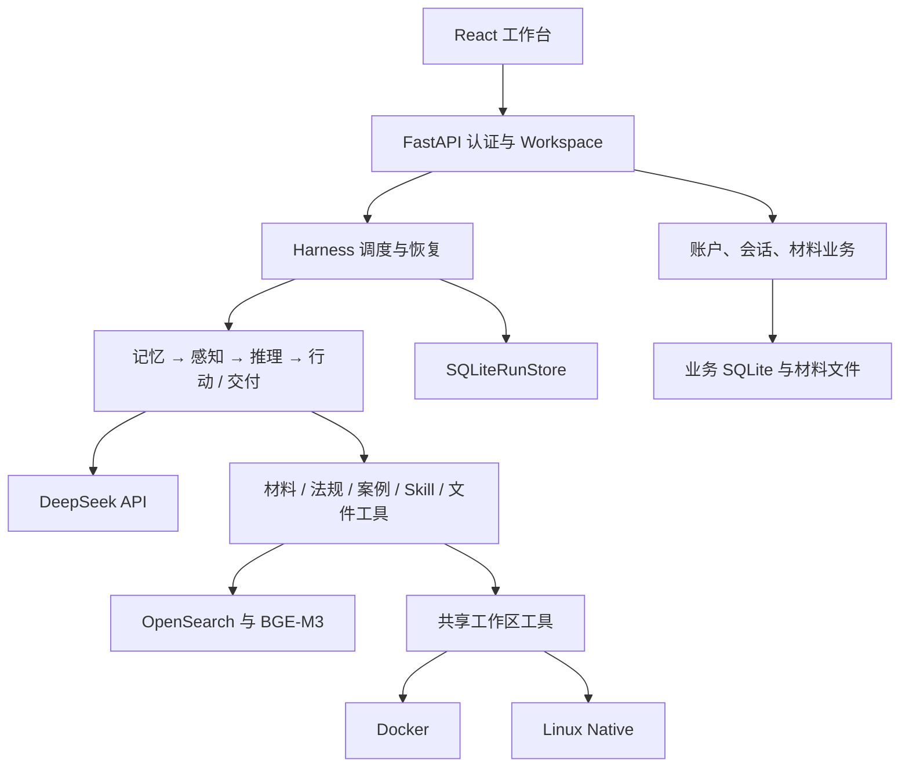

# 当前架构

舟序是前后端分离的模块化单体。`bootstrap.py` 负责具体实现的组装与生命周期，Harness 通过公共端口调用模块和工具。

## 一次任务如何运行

用户先登录，在 Conversation 中上传材料、提出目标。执行器验证账户、绑定范围和幂等请求，创建或恢复 Run。模型根据实际上下文交付正文、调用业务工具或请求必要补充。工具回执进入检查点和下一轮上下文；后台同步授权历史，前端消费快照与 NDJSON 事件。

## 职责与依赖方向

| 层 | 职责 |
| --- | --- |
| `interfaces/` | HTTP 输入输出、认证、公开投影和流式传输 |
| `application/` | 账户、项目、会话、材料归属及工作台业务 |
| `harness/` | 排队、主循环、检查点、补充、停止与恢复 |
| `modules/` | 感知、记忆、推理、行动、结构反思与动态 RAG |
| `contracts/` | 模块载荷、公共事件、运行状态及端口 |
| `infrastructure/` | 外部模型、检索、数据库、文件、解析和进程适配 |
| `skills/` | 经显式注册的只读工作方法 |
| `config/` | 提示词、参数、模型能力和运行边界 |

模块通过端口工作，不直接调用其他模块内部实现；具体适配器在组装入口连接。协作、自进化和长期经验尚未实现。

## 对象、模式与材料

- `account_id` 决定资源归属；`auth_session_id` 是登录会话。
- `conversation_id` 是连续工作空间；`run_id` 是一次任务，包含多次模型调用。
- Conversation 创建时固定 chat / work 模式；work 开放受控文件执行，模型思考档位为 none / low / high。
- `material_ids` 是候选范围，省略时继承 Conversation 已绑定材料；显式提供可缩小范围。
- `attached_material_ids` 是当条消息新附的材料，服务端独立验证所有权与绑定，不以此暗中缩小候选范围。
- 解析器保存原始顺序、版本、位置及缺失状态；初始感知只给共享额度内的开头预览和入口，模型按需 `search_material` 定位、`read_material` 连续或按范围读取。
- 解析完成、当前正文可见、工具操作成功和用户任务完成分别表达。读取覆盖与历史引用都不能证明专业结论正确。

## 模型、上下文与工具

生产模型固定 DeepSeek Flash。`model.thinking_mode` 选择 none / low / high，生成预留分别为 8192 / 16384 / 32768 Token；review 与 compaction 关闭思考。工厂拒绝旧供应商路由配置。

主模型使用 auto 工具选择。可直接交付完整最终正文；必要补充通过 `request_user_input`，阶段交付与系统受阻通过显式交付控制。控制在模型适配层解释，业务工具进入 Action；普通问题可以一次调用完成。

唯一完整请求预算位于 `infrastructure/model/budget.py`，包括系统提示、工具定义、当前输入、材料、历史、记忆、上下文索引、续做状态和私有供应商续接。文本采用保守估算，真实 usage 单独记录。60% / 65% / 70% 是应用水位策略。

压力下先缩小可续读的材料表达；旧完整交互的摘要及覆盖范围提交后，再省略工作视图中的旧正文。原记录保存在检查点或授权历史；最新调用与回执保持配对。发送前重新计量，无法满足硬上限时保留状态并受控结束。

`context_inventory` 从本次真正选中的内容重建。历史读过、摘要或裸引用不算本次全文可见；最新用户补充和续做状态位于索引之后并进入同一预算。供应商隐藏推理只用于按 Run 隔离的私有协议续接与检查点，不进入公开流、普通 Trace 或业务记忆正文。

## 检索与专业方法

法规工具默认每次做一轮 BM25 + BGE-M3 向量检索、RRF 融合和完整片段预算；`rag.review_enabled=false`，主模型依据证据自主决定是否补查。内部证据审查端口保留，可配置启用。初始感知不自动检索，不增加业务意图分类器。

案例通过 `search_cases/read_case` 使用独立固定快照与物理索引，和法规检索共享编码器及认证客户端。运行期间固定启动时的数据版本；发布索引和切换快照需显式操作。故障、无命中、部分结果与来源不符分别处理。

`read_skill` 只能读取显式注册表中的方法文档；实时资料仍由受控工具取得，Skill 不绕过权限、预算或来源校验。

## 执行环境与文件

`execution/workspace.py` 统一 read / write / edit / bash、账户与会话目录、版本冲突、产物、预览和回收。`docker.py/native.py` 实现 `CommandRuntime` 进程边界。文件内容与编辑补丁经标准输入传输。

Docker 默认限制网络、根文件系统、权限和资源。Native 使用专用 Linux 服务账号及进程组、时限和资源限制，适合受控专用部署。会话文件持续保存，Run 收尾释放进程；跨账户目录分开不等于操作系统沙箱。

## 状态、恢复与公开事件

运行包含 queued、running、waiting_user、completed、failed、stopped、interrupted。等待补充时默认发送恢复原 Run；运行中普通发送排队，显式调整使用 steer。原始目标保留，较新要求另外记录。

阶段交付保存可用正文及 remaining_work 后继续；达到一轮执行上限可 yielded 回到同一 Run。停止和打断保留已有正文，continue 使用同一检查点；retry 新建来源关联的 Run。未知副作用不自动重放。

业务 SQLite 保存账户、授权历史和材料信息；SQLiteRunStore 保存私有检查点、公开事件序号和可见正文，以文件锁限定单服务进程。启动自动调度持久化的 queued/running；手动停止、打断和等待补充不自动恢复。旧 JSON 仅作已有数据的读取迁移源。

NDJSON 以 run_id + sequence 去重和续接。`delta` 追加，`answer` 权威替换，`done` 提交可见文本；done 不等于整个 Run 进入终态，生命周期与快照为准。前端显示缓冲不影响标准正文、事件序号或持久化。

## 现有边界

当前不提供跨机器调度、多进程 RunStore、外部副作用 exactly-once、独立语义裁判或法律正确率承诺。结构反思只验证完整性。复杂 OCR / PDF 版面与可选 MinerU 需要独立环境及真实材料验收。

源码中的检查入口见[根目录说明](../README.md)，验收输入见[测试集](../datasets/README.md)，上线条件见[部署说明](deployment.md)。
